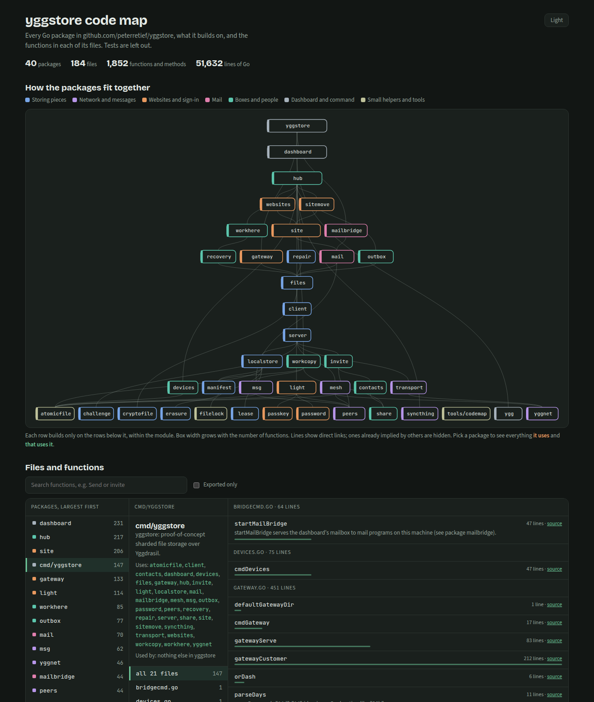

# codemap

One HTML page that maps a Go module: every package, what it builds on
within the module, and the functions in each of its files. Search it, click
a package to see what it uses and what uses it, and, for a module on
GitHub, jump to any function's line. Tests are left out.

[](https://get.withcare.co.za/code-map/)

Open [that example](https://get.withcare.co.za/code-map/) to try it.

## Use it

In your module's folder, with Go 1.24 or later:

```sh
go run github.com/peterretief/codemap@latest -o code-map.html
```

Then open `code-map.html` in a browser. It's one file with nothing to serve,
so it can go on any website. `-root DIR` maps another folder.

It's been checked against a plain-text count on cobra, gin, hugo, prometheus
and kubernetes: packages, files and functions all match. Kubernetes (1,278
packages, 34,823 functions) takes under 2 seconds and makes a 4.5 MB page.

## In GitHub Actions

```yaml
- uses: actions/checkout@v4
- uses: peterretief/codemap@v0.2.0
  with:
    output: code-map.html
- uses: actions/upload-artifact@v4
  with:
    name: code-map
    path: code-map.html
```

## How it reads the map

- Each row builds only on the rows below it, so the foundations are at the
  bottom and your commands at the top.
- A long row wraps onto more lines, and the map scrolls, so names stay readable
  however big the module is.
- Wider boxes have more functions, and colours are top-level folders.
- Lines show direct links; ones already implied by others appear when you
  pick a package.
- `internal/` is left off names. `vendor`, `testdata` and folders with their
  own `go.mod` are left out.
- The page loads its fonts from Google Fonts, and falls back to system fonts
  without them.

## Other languages

[perl-codemap](https://github.com/interrupt21h/perl-codemap) does the same for
Perl.

## Licence

MIT
